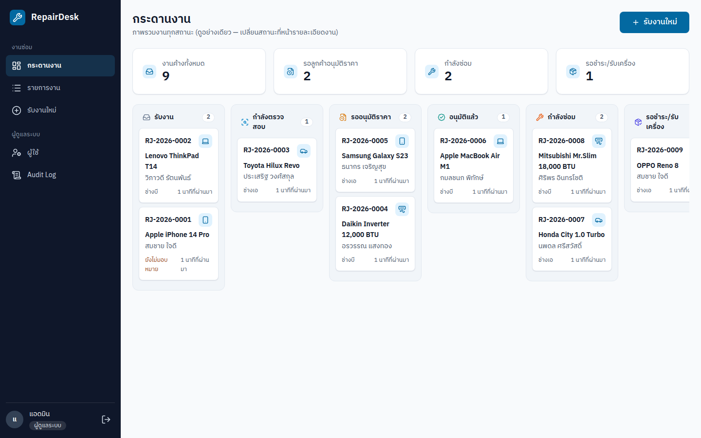
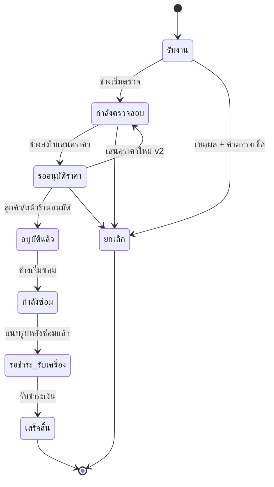
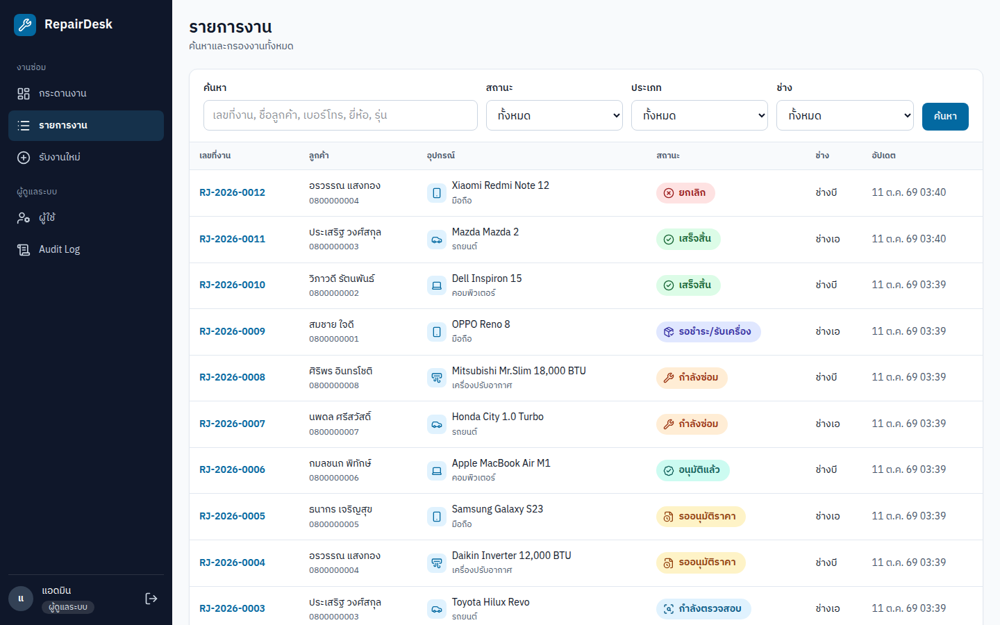
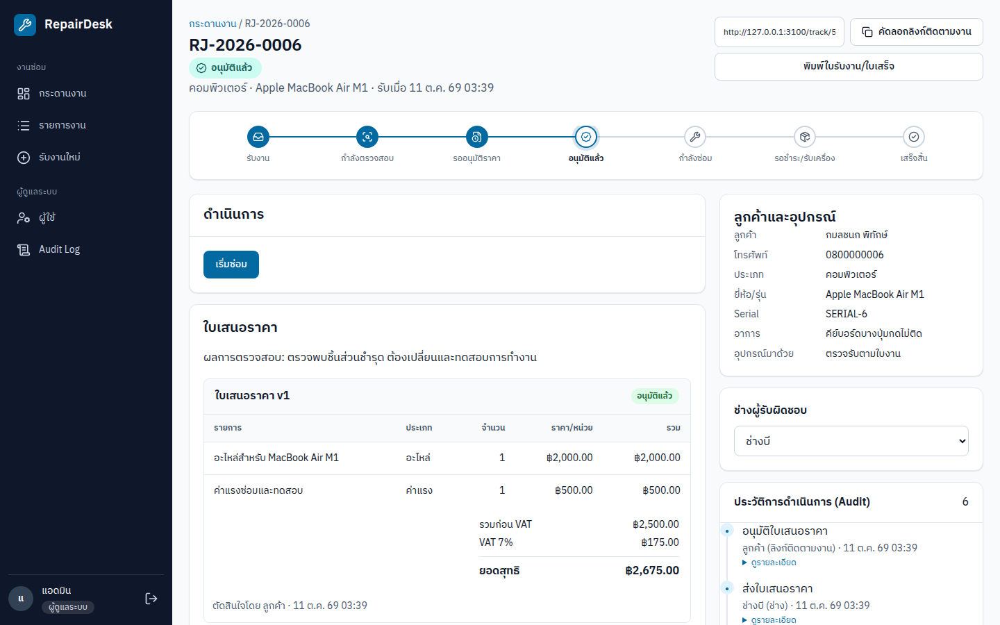
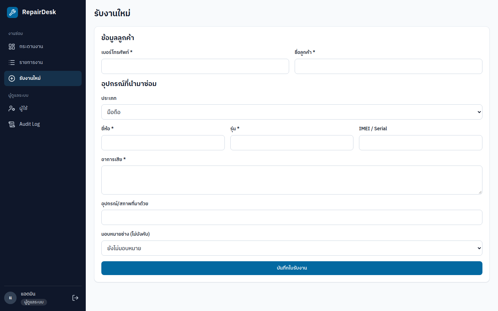
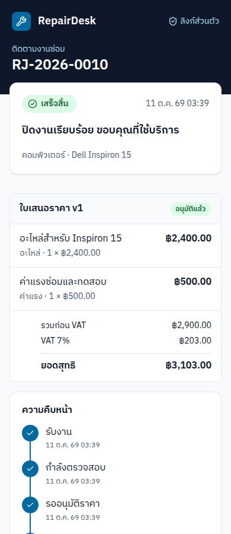
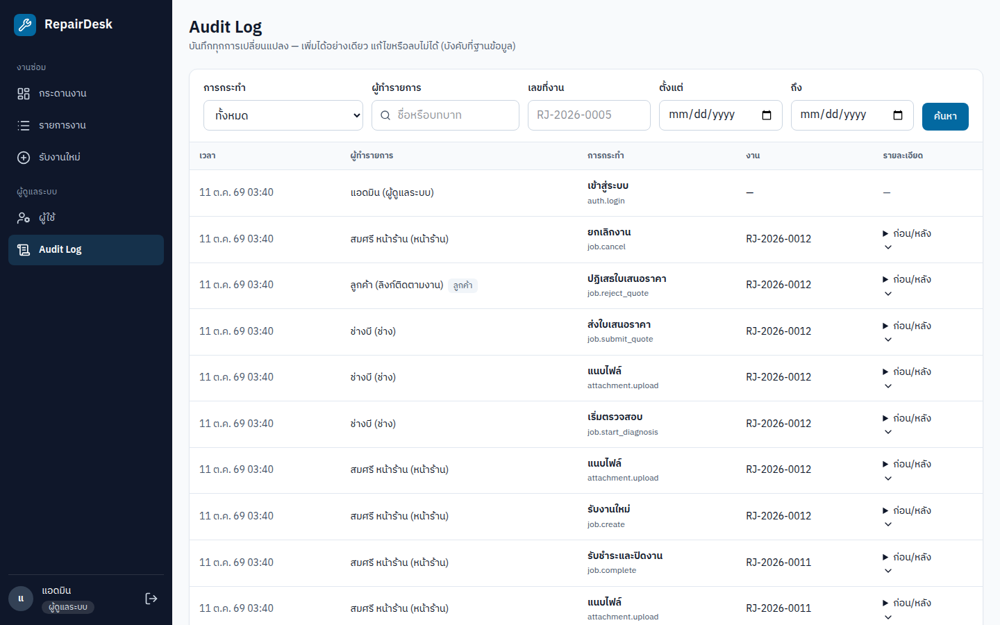
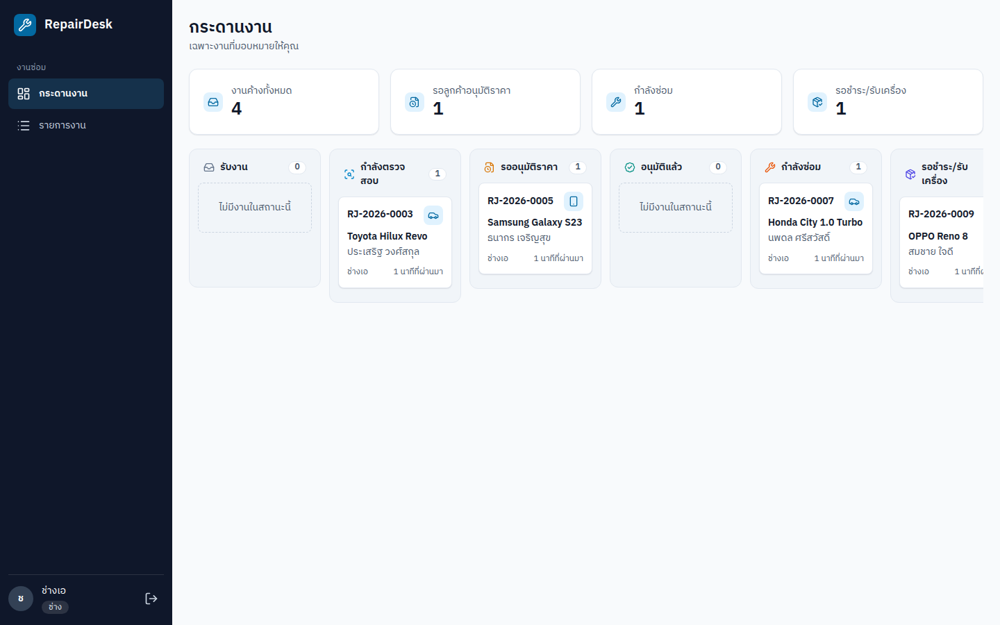
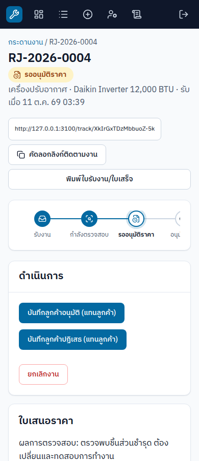

# RepairDesk — ระบบรับงานซ่อม

เว็บแอปจัดการงานซ่อมสำหรับร้านซ่อมมือถือ คอมพิวเตอร์ รถยนต์ และเครื่องปรับอากาศ
ข้อมูลจริงใน SQLite ไฟล์แนบบนดิสก์ ไม่มี mock backend — ทุกสถานะที่เห็นคือข้อมูลที่บันทึกลงฐานข้อมูลแล้ว

**[รับงาน → ตรวจสอบ → เสนอราคา → อนุมัติ → ซ่อม → ชำระเงิน]** พร้อมทางออกสำหรับงานที่ลูกค้าปฏิเสธราคา



`Next.js 16` · `React 19` · `TypeScript` · `Prisma 7 + SQLite` · `Tailwind CSS 4` · `Auth.js 5` · `Vitest` · `Playwright`

---

## สารบัญ

- [สิ่งที่ระบบทำได้](#สิ่งที่ระบบทำได้)
- [ภาพหน้าจอ](#ภาพหน้าจอ)
- [เริ่มใช้งานในเครื่อง](#เริ่มใช้งานในเครื่อง)
- [บัญชีทดลอง](#บัญชีทดลอง)
- [ข้อมูลตัวอย่างหลัง seed](#ข้อมูลตัวอย่างหลัง-seed)
- [คำสั่งที่ใช้บ่อย](#คำสั่งที่ใช้บ่อย)
- [โครงสร้างโปรเจกต์](#โครงสร้างโปรเจกต์)
- [การตัดสินใจเชิงออกแบบ](#การตัดสินใจเชิงออกแบบ)
- [การทดสอบ](#การทดสอบ)
- [ข้อจำกัดที่ตั้งใจไว้](#ข้อจำกัดที่ตั้งใจไว้)
- [เอกสารเพิ่มเติม](#เอกสารเพิ่มเติม)

---

## สิ่งที่ระบบทำได้

### 1. Workflow และสถานะงาน

ใบงานหนึ่งใบเดินตามลำดับสถานะที่กำหนดไว้ตายตัว ระบบปฏิเสธทุกคำสั่งที่กระโดดข้ามขั้นหรือทำผิดสถานะ



- **กระดานงาน** แสดงทุกสถานะเป็นคอลัมน์ พร้อมช่องสรุปงานค้าง — อ่านอย่างเดียว ไม่มีการลากการ์ดเพื่อเปลี่ยนสถานะ
- **รายการงาน** ค้นหาและกรองตามสถานะ ประเภท ช่าง และคำค้น (เลขที่งาน, รุ่น, ชื่อหรือเบอร์ลูกค้า) แบ่งหน้า 20 รายการ
- ทุกคำสั่งที่เปลี่ยนสถานะกระทบ `revision` ของงาน ถ้าหน้ายังค้างอยู่ที่ข้อมูลเก่า ระบบปฏิเสธและแจ้งให้รีเฟรช

### 2. บทบาทและสิทธิ์

| บทบาท | เข้าระบบ | ทำอะไรได้ | มองไม่เห็น |
| --- | --- | --- | --- |
| ผู้ดูแลระบบ (ADMIN) | email + รหัสผ่าน | ทุกอย่าง รวมถึงจัดการผู้ใช้และ Audit Log | — |
| หน้าร้าน (FRONT_DESK) | email + รหัสผ่าน | รับงาน มอบหมายช่าง อนุมัติ/ปฏิเสธแทนลูกค้า เสนอราคาใหม่ ยกเลิก รับชำระ พิมพ์เอกสาร | หน้า Admin, การเริ่มตรวจ/ซ่อมของช่าง |
| ช่าง (TECHNICIAN) | email + รหัสผ่าน | เฉพาะงานที่ได้รับมอบหมาย: เริ่มตรวจ สร้างใบเสนอราคา เริ่มซ่อม แนบรูป ซ่อมเสร็จ | งานของช่างคนอื่น (แสดงเป็น “ไม่พบข้อมูล”), รับงานใหม่, หน้า Admin |
| ลูกค้า (ไม่มีบัญชี) | ลิงก์ติดตาม `/track/<token>` | ดูสถานะ ใบเสนอราคา รูป และการชำระเงิน; อนุมัติหรือปฏิเสธราคา | ชื่อพนักงาน, Audit ภายใน, สลิปโอน |

- บทบาทถูกอ่านจากฐานข้อมูลใหม่ทุกคำขอ — เปลี่ยน role หรือปิดใช้งานบัญชีแล้วมีผลทันทีกับเซสชันเดิม
- เมนูด้านซ้ายและปุ่มที่ทำได้ ปรับตามบทบาทและขนาดหน้าจอ
- บัญชีที่ถูกปิดใช้งานถูกเด้งกลับหน้าเข้าสู่ระบบ

### 3. ใบเสนอราคา

- ค่าแรงและค่าอะไหล่แยกบรรทัด กำหนดจำนวนและราคาต่อหน่วยได้
- คำนวณ VAT 7% จากยอดรวมก่อน VAT แล้วปัดเป็นสตางค์
- **เก็บเงินเป็นจำนวนเต็มหน่วยสตางค์** ไม่ใช้ทศนิยมลอยตัว ป้องกันการสะสมความคลาดเคลื่อน
- ทุกครั้งที่เสนอใหม่จะได้เวอร์ชันใหม่ (v1, v2, …) และเก็บประวัติเดิมไว้ครบ
- หน้าร้านตัดสินใจแทนลูกค้าได้ แต่ Audit ระบุชัดว่าเป็นการทำ “แทนลูกค้า”

### 4. ไฟล์แนบ

- รองรับ JPG, PNG, WEBP และ PDF ขนาดไม่เกิน 10 MB
- ตรวจทั้ง MIME type และลายเซ็นไบต์จริงของไฟล์ ไม่เชื่อนามสกุลหรือ header ที่ส่งมา
- แบ่งขั้นการแนบตามบทบาท: รับเครื่อง, ผลตรวจ, ก่อนซ่อม, หลังซ่อม, สลิปโอน
- งานที่ปิดแล้วแนบเพิ่มไม่ได้; การแนบรูปหลังซ่อมเป็นเงื่อนไขก่อนกด “ซ่อมเสร็จ”
- ไฟล์ถูกเก็บนอก public directory และดาวน์โหลดผ่าน route ที่ตรวจสิทธิ์ทุกครั้ง

### 5. Audit Log

- ทุก mutation บันทึกผู้ทำ เวลา ค่าก่อน และค่าหลัง
- ฐานข้อมูลมี trigger ปฏิเสธ `UPDATE` และ `DELETE` บนตาราง AuditLog — แก้ย้อนหลังไม่ได้
- ไม่บันทึกรหัสผ่านหรือ hash ลงใน log
- มี timeline ในใบงาน และหน้า Audit Log สำหรับ Admin ที่กรองตามการกระทำ ผู้ทำ เลขที่งาน และช่วงวันที่ได้

### 6. ลิงก์ติดตามสำหรับลูกค้า

- ลูกค้าไม่ต้องมีบัญชี ใช้ลิงก์ส่วนตัวที่มี token สุ่ม 24 ไบต์ (32 ตัวอักษร) เป็น bearer credential
- หน้าลูกค้าเลือกคอลัมน์ที่จะแสดงแยกจากกัน จึงไม่มีทางหลุดชื่อพนักงาน, โน้ตภายใน, Audit หรือสลิปโอนออกไปในหน้าเว็บหรือ payload
- token เปิดไฟล์สลิปโอนไม่ได้ (route ตรวจขั้นของไฟล์ก่อนเสมอ)

### 7. การชำระเงินและเอกสาร

- รับชำระเต็มยอดตามใบเสนอราคาที่อนุมัติ: เงินสด โอน หรือบัตร
- การโอนต้องมีสลิปแนบก่อนจึงจะปิดงานได้
- การยกเลิกต้องระบุเหตุผล และคิดค่าตรวจเช็คได้ (0 บาทก็ได้ แต่ถ้าคิดเงินต้องเลือกวิธีรับชำระ)
- มีใบรับงานและใบเสร็จรับเงินเป็น HTML สำหรับพิมพ์จากเบราว์เซอร์

---

## ภาพหน้าจอ

ภาพทั้งหมดถ่ายจากแอปจริงที่รันบนข้อมูล demo (ดูที่มาที่ [`docs/screenshots/`](docs/screenshots/))

| หน้าจอ | รายละเอียด |
| --- | --- |
|  | **กระดานงาน** — งานทุกสถานะเป็นคอลัมน์ พร้อมช่องสรุปงานค้าง |
|  | **รายการงาน** — ค้นหาและกรองตามสถานะ/ประเภท/ช่าง |
|  | **รายละเอียดงาน** — stepper, ใบเสนอราคา, ประวัติการดำเนินการ |
|  | **รับงานใหม่** — ข้อมูลลูกค้า อุปกรณ์ และอาการ |
|  | **หน้าลูกค้า (มือถือ)** — ดูสถานะและอนุมัติราคาผ่านลิงก์ |
|  | **Audit Log** — กรองได้ เปิดดูค่าก่อน/หลังได้ |
|  | **ใบรับงาน / ใบเสร็จ** — พิมพ์จากเบราว์เซอร์ |
|  | **กระดานของช่าง** — เห็นเฉพาะงานที่ได้รับมอบหมาย |
|  | **หน้างานบนมือถือ** — ผู้ช่วยตัดสินใจแทนลูกค้าและยกเลิกงาน |
|  | **จัดการผู้ใช้** — สร้างบัญชี เปลี่ยนบทบาท ปิดใช้งาน |

---

## เริ่มใช้งานในเครื่อง

**ต้องมี:** Node.js 24 (พัฒนาบน v24.16.0) และ npm — SQLite ไม่ต้องติดตั้ง database server

```bash
git clone https://github.com/hirun-2542/RepairDesk.git
cd RepairDesk
npm install
cp .env.example .env          # แล้วแก้ AUTH_SECRET ด้วยค่าที่สุ่มเอง
npx prisma generate
npx prisma migrate deploy
npm run db:seed
npm run dev                   # http://localhost:3000
```

สร้าง `AUTH_SECRET` ด้วย `openssl rand -base64 32` แล้วนำผลไปใส่ใน `.env`

```dotenv
DATABASE_URL="file:./dev.db"
AUTH_SECRET="<ค่าที่สุ่มเอง>"
AUTH_TRUST_HOST=true
UPLOAD_DIR="./uploads"
```

> `.env.example` มีค่า secret ตัวอย่างที่ใช้จริงไม่ได้ — ต้องสร้างใหม่เสมอ

### เริ่มข้อมูล demo ใหม่

```bash
npm run db:reset     # ลบข้อมูลใน DATABASE_URL แล้ว migrate + seed ใหม่
```

คำสั่งนี้ทำลายข้อมูลในฐานข้อมูลที่ชี้อยู่ **ห้ามใช้กับข้อมูลลูกค้าจริง** และ Prisma จะบล็อกถ้ารันโดย AI agent เว้นแต่ผู้ใช้ยืนยันชัดเจน

ทางเลือกที่ไม่ทำลายไฟล์เดิม: ชี้ `DATABASE_URL` ไปไฟล์ใหม่แล้ว migrate + seed เฉพาะไฟล์นั้น

```bash
DATABASE_URL="file:./demo-fresh.db" npx prisma migrate deploy
DATABASE_URL="file:./demo-fresh.db" npm run db:seed
```

seed จะปฏิเสธถ้าฐานข้อมูลไม่ว่าง และล้างเฉพาะไฟล์ที่แอปสร้างเองใน upload directory (ชื่อ UUID)

---

## บัญชีทดลอง

รหัสผ่านทุกบัญชีคือ `demo1234` หรือกดปุ่ม **Demo login** ที่หน้าเข้าสู่ระบบ

| อีเมล | บทบาท |
| --- | --- |
| `admin@demo.local` | ผู้ดูแลระบบ |
| `frontdesk@demo.local` | หน้าร้าน |
| `tech1@demo.local` | ช่างเอ |
| `tech2@demo.local` | ช่างบี |

## ข้อมูลตัวอย่างหลัง seed

ตรวจจากฐานข้อมูลจริงหลัง seed: ผู้ใช้ 4 คน, ลูกค้า 8 คน, ใบงาน 12 ใบ, Audit 86 รายการ

| สถานะ | จำนวนงาน |
| --- | ---: |
| รับงาน | 2 |
| กำลังตรวจสอบ | 1 |
| รออนุมัติราคา | 2 |
| อนุมัติแล้ว | 1 |
| กำลังซ่อม | 2 |
| รอชำระ/รับเครื่อง | 1 |
| เสร็จสิ้น | 2 |
| ยกเลิก | 1 |

ชุดข้อมูลนี้มีกรณีที่ต้องการทดสอบครบ: งานที่ลูกค้าปฏิเสธ v1 แล้วเสนอ v2, งานชำระเงินสด, งานโอนพร้อมสลิป, งานยกเลิกที่เก็บค่าตรวจเช็ค 300 บาท และงานครบทั้ง 4 ประเภทอุปกรณ์ ไฟล์ตัวอย่างเป็น PNG จริงขนาดเล็กสำหรับทดสอบการแนบ ไม่ใช่ภาพลูกค้าจริง

---

## คำสั่งที่ใช้บ่อย

| คำสั่ง | ทำอะไร |
| --- | --- |
| `npm run dev` | เริ่ม dev server |
| `npm run build` | generate Prisma client, type-check และ production build |
| `npm start` | รัน production build |
| `npm test` | unit test (Vitest) ของ domain logic |
| `npm run e2e` | Playwright ไล่ workflow ผ่าน UI จริงบนฐานข้อมูลชั่วคราว |
| `npm run db:seed` | ใส่ข้อมูล demo (ต้องเป็นฐานข้อมูลว่าง) |
| `npm run db:reset` | ล้างแล้ว seed ใหม่ — ทำลายข้อมูล |
| `npm run db:migrate` | สร้าง migration ใหม่ระหว่างพัฒนา |

---

## โครงสร้างโปรเจกต์

```text
src/
├── app/                 # routes (App Router)
│   ├── (staff)/         # หน้าสำหรับพนักงาน: กระดาน รายการ ใบงาน Admin
│   ├── track/[token]/   # หน้าลูกค้าผ่านลิงก์ติดตาม
│   ├── files/[id]/      # route เดียวที่เสิร์ฟไฟล์แนบ (ตรวจสิทธิ์ทุกครั้ง)
│   └── api/             # NextAuth และ upload endpoint
├── domain/              # กฎธุรกิจล้วน ไม่พึ่ง DB: workflow, เงิน, สิทธิ์, label
├── server/              # service ที่ทำงานกับ DB: ใบงาน ใบเสนอราคา ชำระเงิน Audit
├── components/          # UI (Radix + Tailwind)
└── lib/                 # Prisma client, session helper
prisma/
├── schema.prisma        # 8 model, 8 enum
├── migrations/          # SQL migration รวม trigger ของ Audit Log
└── seed.ts              # ข้อมูล demo
e2e/                     # Playwright: happy path, สิทธิ์, concurrency, การยกเลิก
docs/
├── adr/                 # บันทึกการตัดสินใจ (ADR)
└── screenshots/         # ภาพหน้าจอจากแอปจริง
design/                  # prototype และ design system (แยกจากแอปจริง)
```

---

## การตัดสินใจเชิงออกแบบ

| เรื่อง | ทางที่เลือก | เหตุผล |
| --- | --- | --- |
| เงิน | เก็บเป็นจำนวนเต็มสตางค์ | หลีกเลี่ยง floating point และการปัดเศษสะสมในใบเสนอราคาและการชำระเงิน |
| สิทธิ์ | ตรวจจากฐานข้อมูลทุกคำขอ ไม่เชื่อ JWT | เปลี่ยนบทบาทหรือปิดบัญชีต้องมีผลทันที ไม่ต้องรอ token หมดอายุ |
| Concurrency | ทุก mutation ส่ง `revision` ของงานที่อ่านมา | สองคนแก้พร้อมกันจะสำเร็จครั้งเดียว อีกฝ่ายได้ข้อความให้รีเฟรช |
| Audit | trigger ระดับฐานข้อมูลห้าม UPDATE/DELETE | แอปที่ถูกแก้หรือ bug ไม่สามารถลบร่องรอยได้ |
| ลูกค้า | bearer token แทนบัญชี | ลูกค้ามาใช้ครั้งเดียวต่อการซ่อม ไม่ควรต้องจำรหัสผ่าน |
| ไฟล์แนบ | เก็บนอก public + route ตรวจสิทธิ์ | ไฟล์ไม่สามารถเข้าถึงได้ด้วยการเดา URL |
| Domain logic | แยก `src/domain` ที่ไม่พึ่ง DB | ทดสอบกฎ workflow/เงิน/สิทธิ์ได้เร็วและครอบคลุม |

รายละเอียดเพิ่มเติม: [`docs/adr/0001-customer-access-via-tracking-link.md`](docs/adr/0001-customer-access-via-tracking-link.md)

---

## การทดสอบ

```bash
npm test         # Vitest — 4 ไฟล์ 125 tests: workflow, เงิน, สิทธิ์, ตัวกรอง Audit
npm run e2e      # Playwright — ไล่ flow จริงบน Chromium
npm run build    # type-check + production build
```

ชุด e2e สร้างฐานข้อมูลและ upload directory ใหม่ใน temp directory ของทุกรอบ แล้ว teardown ตรวจว่าฐานข้อมูลในโปรเจกต์ไม่ถูกแตะต้อง จึงรันซ้ำได้โดยไม่ทำข้อมูล dev เสีย

---

## ข้อจำกัดที่ตั้งใจไว้

ระบบนี้เป็น demo สำหรับร้านเดียวบนเครื่องเดียว ไม่ใช่ production deployment:

- ไม่มี payment gateway — บันทึกวิธีรับเงินเท่านั้น
- ไม่มีการแจ้งเตือน (อีเมล/SMS/LINE), multi-tenant, สต็อกอะไหล่, นัดหมายนอกสถานที่ หรือการชำระบางส่วน
- ลูกค้าไม่มีบัญชีและไม่มีระบบสมาชิก
- ทดสอบบน Chromium เท่านั้น ยังไม่ทดสอบ Firefox, Safari, อุปกรณ์จริง หรือ screen reader
- ทดสอบ PDF ผ่าน browser print แต่ยังไม่ได้ทดสอบเครื่องพิมพ์จริง
- `next` เวอร์ชันที่ใช้มีคำแนะนำให้อัปเกรดด้านความปลอดภัย ควรอัปเกรดก่อนนำไปใช้งานจริง

---

## เอกสารเพิ่มเติม

| ไฟล์ | เนื้อหา |
| --- | --- |
| [`GLOSSARY.md`](GLOSSARY.md) | คำศัพท์ของโดเมน (ใบงาน, ลูกค้า, อุปกรณ์, บทบาท) |
| [`docs/adr/`](docs/adr/) | บันทึกการตัดสินใจเชิงสถาปัตยกรรม |
| [`design/README.md`](design/README.md) | User flow, sitemap, wireframe, design system และ prototype |

## สิทธิ์การใช้งาน

ไม่ได้ให้สัญญาอนุญาต (all rights reserved) — โค้ดนี้เผยแพร่เพื่อเป็นตัวอย่างผลงาน ไม่ได้อนุญาตให้นำไปใช้ต่อโดยไม่ได้รับความยินยอม
