# RepairDesk

**ระบบรับงานซ่อมสำหรับร้านมือถือ / คอมพิวเตอร์ / รถยนต์ / เครื่องปรับอากาศ** — หน้าร้านรับเครื่องและมอบหมายช่าง ช่างเสนอราคาและซ่อม ลูกค้าอนุมัติผ่านลิงก์ส่วนตัวโดยไม่ต้องมีบัญชี และทุกการเปลี่ยนแปลงถูกบันทึกใน Audit Log ที่แก้ไขไม่ได้

UI ภาษาไทยทั้งหมด mobile-first สไตล์ Clarity First (ขาวสะอาด + น้ำเงินเข้ม) รันในเครื่องได้ด้วย SQLite ไฟล์เดียว ไม่ต้องมี database server

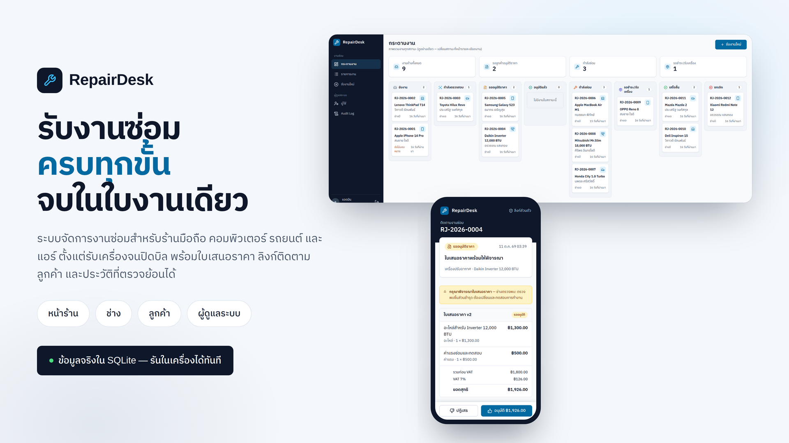

---

## สารบัญ

- [ภาพรวม](#ภาพรวม)
- [ฟีเจอร์](#ฟีเจอร์)
- [หน้าจอ](#หน้าจอ)
- [สถาปัตยกรรม](#สถาปัตยกรรม)
- [เริ่มใช้งาน](#เริ่มใช้งาน)
- [โหมด Demo](#โหมด-demo)
- [การพัฒนา](#การพัฒนา)
- [การทดสอบ](#การทดสอบ)
- [โครงสร้างโปรเจกต์](#โครงสร้างโปรเจกต์)
- [เอกสาร](#เอกสาร)
- [ข้อจำกัดและหมายเหตุ](#ข้อจำกัดและหมายเหตุ)

---

## ภาพรวม

ร้านรับซ่อมขนาดเล็กมักเก็บงานไว้ในสมุดหรือแชท ใบเสนอราคาหลงหาย รูปก่อน–หลังซ่อมกระจัดกระจาย และเมื่อลูกค้าถามว่างานถึงไหนก็ต้องรื้อหาทีละใบ RepairDesk แทนที่ทั้งวงจรนั้นด้วยใบงานเดียวที่เดินตามสถานะตายตัว:

| บทบาท | อุปกรณ์ | สิ่งที่ทำได้ |
|---|---|---|
| **หน้าร้าน** | เดสก์ท็อป / มือถือ | รับงานใหม่ มอบหมายช่าง ติดต่อเรื่องราคา อนุมัติ/ปฏิเสธแทนลูกค้า เสนอราคาใหม่ ยกเลิกพร้อมค่าตรวจเช็ค รับชำระ พิมพ์เอกสาร |
| **ช่าง** | เดสก์ท็อป / มือถือ | เห็นเฉพาะงานที่ได้รับมอบหมาย: เริ่มตรวจ สร้างใบเสนอราคา แนบรูปผลตรวจ/ก่อน/หลังซ่อม เริ่มซ่อม ปิดงานซ่อม |
| **ลูกค้า** | มือถือ (ลิงก์ส่วนตัว) | ดูสถานะ ใบเสนอราคา รูป และการชำระเงิน อนุมัติหรือปฏิเสธราคาได้เอง ไม่ต้องสมัครสมาชิก |
| **ผู้ดูแลระบบ** | เดสก์ท็อป | ทุกอย่างของบทบาทอื่น + จัดการผู้ใช้/บทบาท + Audit Log ที่กรองและตรวจย้อนได้ |

จุดที่ออกแบบมาเพื่องานจริงในร้าน:

- **สถานะเดินหน้าเท่านั้น** — ทุกคำสั่งตรวจสถานะและบทบาทจากฐานข้อมูลทุกครั้ง กระโดดข้ามขั้นไม่ได้ (ดู [`src/domain/workflow.ts`](src/domain/workflow.ts))
- **สองคนแก้พร้อมกันมีผลครั้งเดียว** — คำสั่งเปลี่ยนสถานะ ใบเสนอราคา การมอบหมาย และการชำระเงิน ส่ง `revision` ที่อ่านมากลับไปด้วย ฝ่ายที่แพ้ได้ข้อความให้รีเฟรชแทนข้อมูลทับกัน (การแนบไฟล์เพิ่ม revision งานเพื่อตัดคำสั่งค้างเก่าให้ตกไป)
- **เงินเป็นจำนวนเต็มสตางค์** — ไม่มีทศนิยมลอยตัวในใบเสนอราคา การชำระเงิน และค่าตรวจเช็ค
- **Audit Log ลบไม่ได้จริง** — trigger ในฐานข้อมูลปฏิเสธ `UPDATE`/`DELETE` บนตาราง `AuditLog` ไม่ใช่แค่ซ่อนปุ่มใน UI
- **ลูกค้าเห็นเท่าที่ควรเห็น** — หน้า tracking เลือกคอลัมน์แยกจากหน้าพนักงาน จึงไม่มีชื่อช่าง โน้ตภายใน Audit หรือสลิปโอนหลุดออกไป

---

## ฟีเจอร์

### หน้าร้าน
- **รับงานใหม่**: ลูกค้า (ชื่อ + เบอร์โทร), อุปกรณ์ 4 ประเภท, ยี่ห้อ/รุ่น, อาการ, อุปกรณ์ที่ฝากมา, แนบรูปตอนรับเครื่อง, มอบหมายช่าง
- **กระดานงาน**: 8 คอลัมน์ตามสถานะ + ช่องสรุปงานค้าง รออนุมัติ กำลังซ่อม รอรับเครื่อง — อ่านอย่างเดียว เปลี่ยนสถานะที่หน้ารายละเอียด
- **รายการงาน**: ค้นหาจากเลขที่งาน/รุ่น/ชื่อลูกค้า/เบอร์โทร และกรองตามสถานะ ประเภท ช่าง พร้อมแบ่งหน้า
- **ตัดสินใจแทนลูกค้า**: บันทึกอนุมัติ/ปฏิเสธพร้อมป้าย **แทนลูกค้า** ใน Audit
- **ยกเลิกงาน**: ระบุเหตุผลและคิดค่าตรวจเช็คได้ (0 บาทก็ได้ — ถ้าคิดเงินต้องเลือกวิธีรับชำระ)
- **รับชำระ**: เงินสด โอน (ต้องมีสลิปแนบ) หรือบัตร เต็มยอดใบเสนอราคาที่อนุมัติ
- **พิมพ์เอกสาร**: ใบรับงาน และใบเสร็จรับเงิน พิมพ์จากเบราว์เซอร์

### ช่าง
- เห็นเฉพาะงานที่มอบหมายให้ตน — เปิดงานของช่างคนอื่นได้ “ไม่พบข้อมูล”
- เริ่มตรวจ → ส่งใบเสนอราคา (ค่าแรง/อะไหล่แยกบรรทัด, VAT 7%) → เริ่มซ่อม → ปิดงานซ่อม
- แนบรูปตามขั้น: ผลตรวจ, ก่อนซ่อม, หลังซ่อม
- ปุ่มที่ยังกดไม่ได้แสดงพร้อมเหตุผล เช่น “ต้องแนบรูปหลังซ่อมอย่างน้อย 1 รูป”

### ลูกค้า (ไม่ต้องมีบัญชี)
- เปิดลิงก์ `/track/<token 32 ตัว>` แล้วเห็นความคืบหน้าเป็น stepper, ใบเสนอราคาฉบับล่าสุด, รูป และสรุปการชำระเงิน
- อนุมัติ/ปฏิเสธราคาได้จากมือถือ ปุ่มตัดสินใจติดขอบจอล่างตลอดการเลื่อน
- ไม่เห็นชื่อพนักงาน, โน้ตภายใน, Audit Log หรือสลิปโอน และ token เปิดไฟล์สลิปไม่ได้

### ผู้ดูแลระบบ
- จัดการผู้ใช้: สร้างบัญชี เปลี่ยนบทบาท ปิดใช้งาน — มีผลกับเซสชันเดิมทันที
- **Audit Log**: ทุก mutation พร้อมผู้ทำ เวลา และค่าก่อน/หลัง กรองตามการกระทำ ผู้ทำ เลขที่งาน และช่วงวันที่
- แก้บัญชีตัวเองไม่ได้ และอีเมลซ้ำไม่ได้

### Demo Mode
- ข้อมูลตัวอย่าง 12 ใบงานครบทุกสถานะ ทุกประเภทอุปกรณ์ พร้อมกรณีปฏิเสธราคา → เสนอ v2, งานชำระเงินสด, งานโอนพร้อมสลิป และงานยกเลิกที่เก็บค่าตรวจเช็ค 300 บาท
- ปุ่ม **Demo login** 4 ปุ่มที่หน้าเข้าสู่ระบบ (ผู้ดูแลระบบ / หน้าร้าน / ช่าง 1 / ช่าง 2) — รหัสผ่าน `demo1234` ทุกบัญชี
- `npm run db:reset` คืนข้อมูลกลับเป็นชุดเริ่มต้น

---

## หน้าจอ

### กระดานงาน — ภาพรวมทุกสถานะ

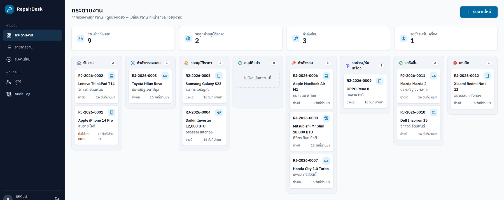

### ใบงาน — stepper, ใบเสนอราคา และ Audit timeline

| งานรออนุมัติราคา (ลูกค้าปฏิเสธ v1) | งานกำลังซ่อม (ยังไม่แนบรูปหลังซ่อม) |
|---|---|
| 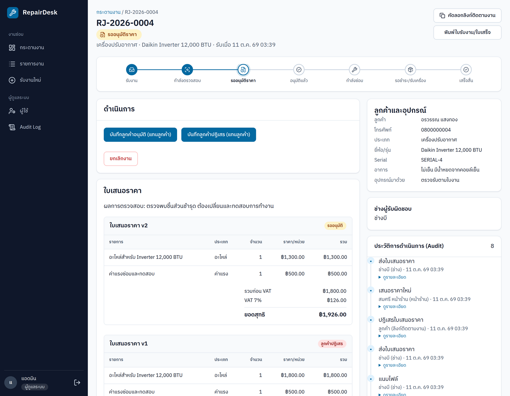 | 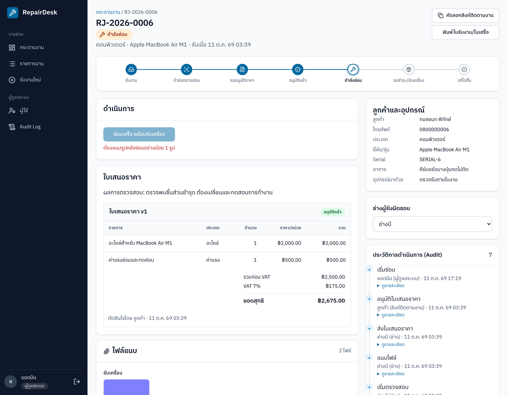 |

### หน้าลูกค้า — เปิดจากลิงก์ส่วนตัวบนมือถือ

| รออนุมัติราคา | ปิดงานแล้ว |
|---|---|
| 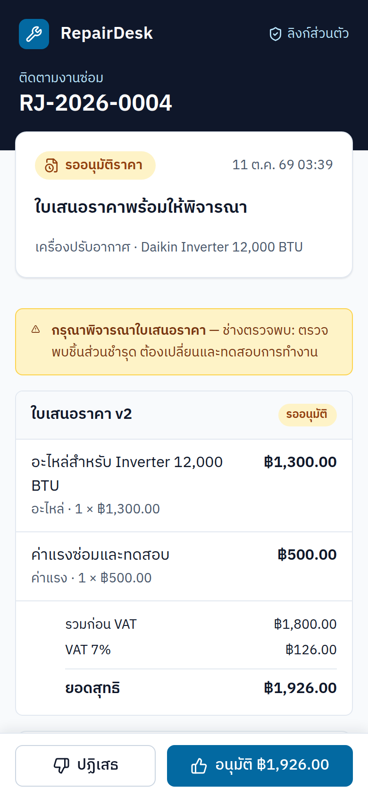 | 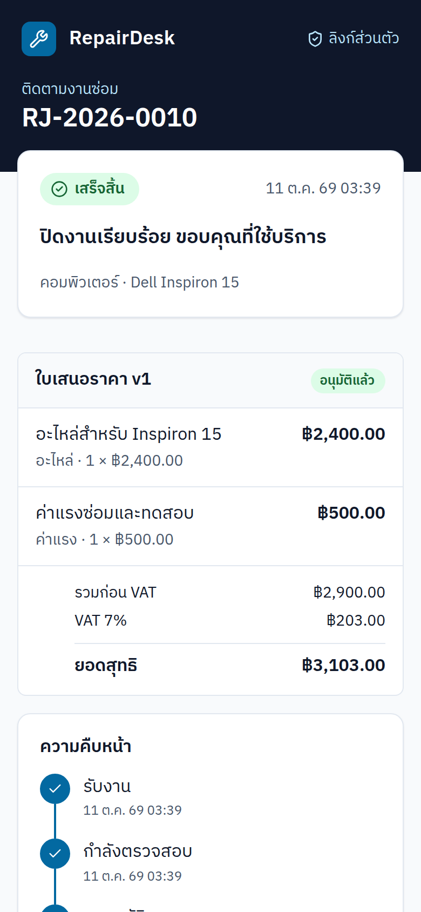 |

### หน้าร้านและผู้ดูแลระบบ

| รับงานใหม่ | รายการงาน | จัดการผู้ใช้ |
|---|---|---|
|  | 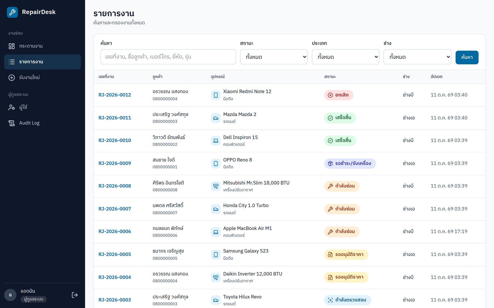 | 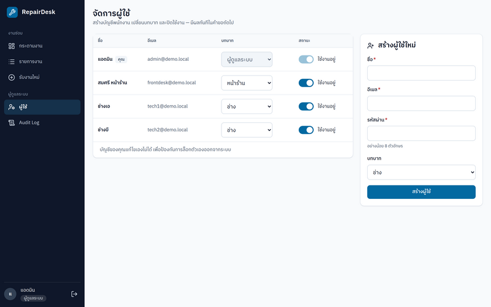 |

| เข้าสู่ระบบ | Audit Log | ใบรับงาน / ใบเสร็จ |
|---|---|---|
| 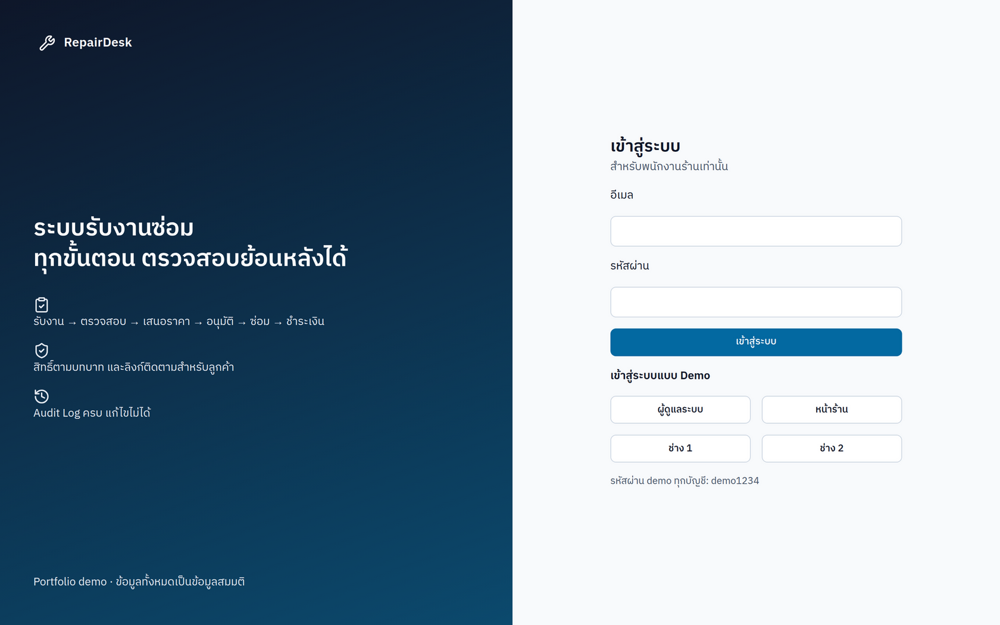 | 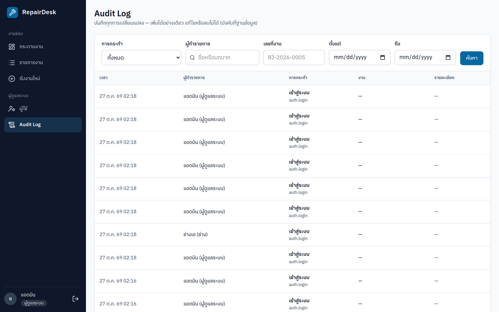 | 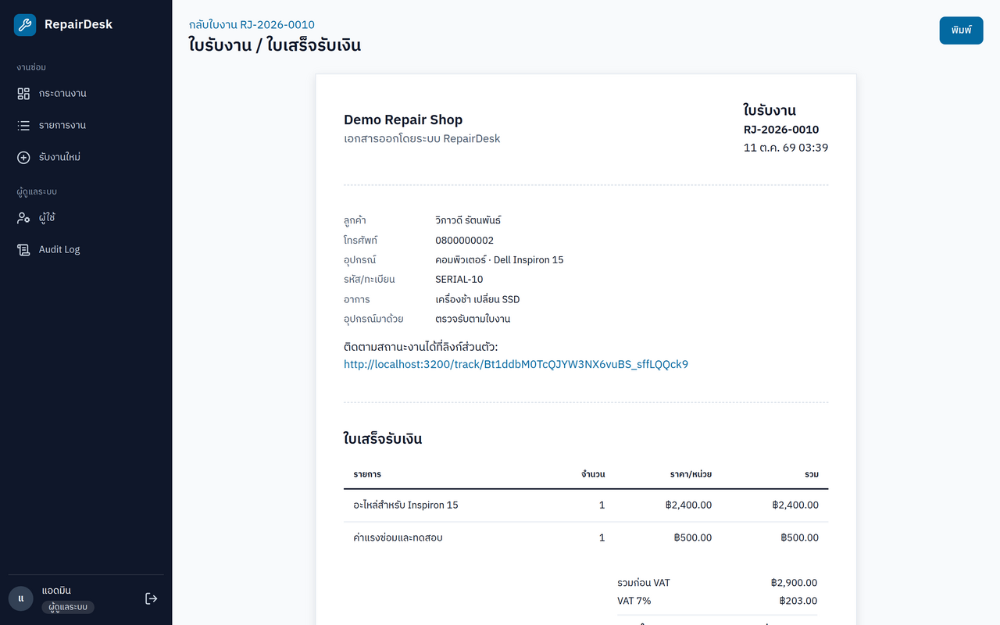 |

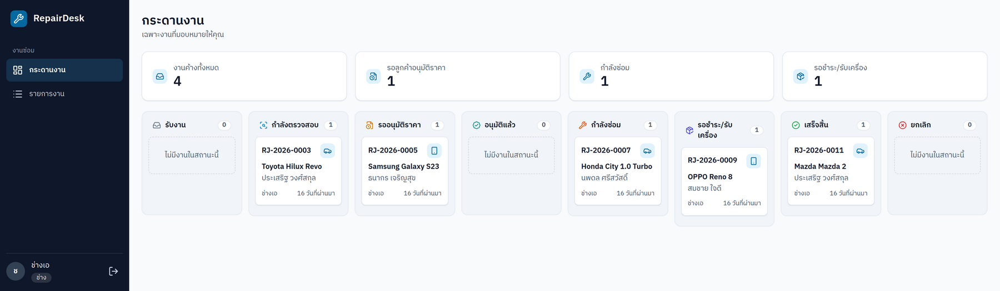

ภาพทั้งหมดถ่ายจากแอปจริงที่รันบนข้อมูล demo (2× DPR) ไม่ใช่ภาพ mockup — mockup และ design system อยู่ใน [`design/`](design) และภาพจาก prototype อยู่ใน [`design/screenshots/`](design/screenshots)

---

## สถาปัตยกรรม

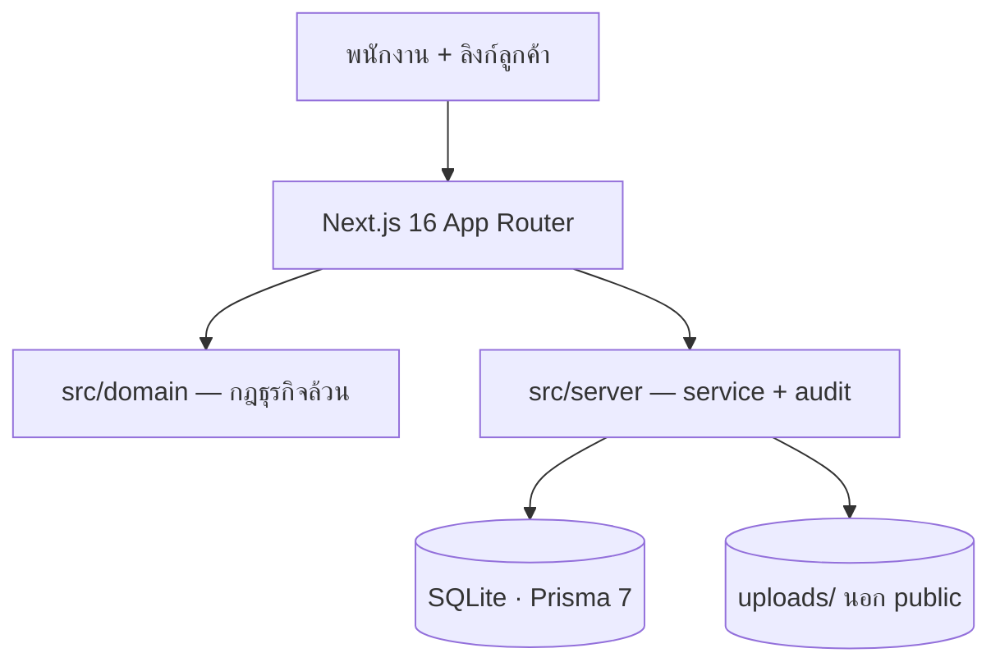

- **กฎธุรกิจแยกจากฐานข้อมูล**: `src/domain/` เป็นฟังก์ชันล้วน (workflow, เงิน, สิทธิ์, label) จึงทดสอบได้เร็วและใช้ร่วมกันระหว่าง UI กับ service
- **service เป็นจุดเดียวที่เขียนฐานข้อมูล**: `src/server/*` ตรวจสิทธิ์ อัปเดตงาน เพิ่ม revision และเขียน Audit ใน transaction เดียวกัน
- **ตรวจสิทธิ์จากฐานข้อมูลทุกคำขอ**: session เก็บแค่ id — บทบาทและสถานะ active อ่านใหม่ทุกครั้ง จึงไม่ต้องรอ token หมดอายุ
- **ไฟล์แนบ**: เก็บนอก `public/` ด้วยชื่อ UUID ตรวจ MIME และลายเซ็นไบต์จริง ดาวน์โหลดผ่าน `/files/[id]` ที่ตรวจสิทธิ์ทุกครั้ง
- **Audit Log**: trigger `audit_log_no_update` / `audit_log_no_delete` ใน migration ปฏิเสธการแก้และลบ

| ชั้น | เทคโนโลยี |
|---|---|
| Frontend | Next.js 16.4 (App Router) · React 19 · TypeScript · Tailwind CSS 4 · Radix UI · lucide-react · IBM Plex Sans Thai |
| Backend | Next.js server actions + route handlers · Auth.js 5 (JWT, credentials) · zod |
| Database | SQLite ผ่าน Prisma 7 + `better-sqlite3` adapter · migration 2 ไฟล์ |
| Tests | Vitest (domain) · Playwright (Chromium, ฐานข้อมูลชั่วคราวแยกทุกรอบ) |

---

## เริ่มใช้งาน

ต้องมี **Node.js 24** และ **npm** เท่านั้น — SQLite ไม่ต้องมี server

```bash
git clone https://github.com/hirun-2542/RepairDesk.git
cd RepairDesk
npm install
cp .env.example .env
```

สร้าง secret แล้วใส่ใน `.env`:

```bash
openssl rand -base64 32
```

```dotenv
DATABASE_URL="file:./dev.db"
AUTH_SECRET="<ค่าที่สุ่มจากคำสั่งข้างบน>"
AUTH_TRUST_HOST=true
UPLOAD_DIR="./uploads"
```

จากนั้นสร้างฐานข้อมูลและข้อมูล demo:

```bash
npx prisma generate
npx prisma migrate deploy
npm run db:seed
npm run dev
```

เปิด **<http://localhost:3000>** — หน้าเข้าสู่ระบบมีปุ่ม Demo login ทั้ง 4 บทบาท

### ตัวแปรสภาพแวดล้อม

| ตัวแปร | ค่าเริ่มต้น | ความหมาย |
|---|---|---|
| `DATABASE_URL` | `file:./dev.db` | ไฟล์ SQLite ที่ใช้ (path อ้างจากรากโปรเจกต์) |
| `AUTH_SECRET` | — | secret ของ Auth.js ต้องสร้างใหม่เอง ห้ามใช้ค่าตัวอย่าง |
| `AUTH_TRUST_HOST` | `true` | ให้ Auth.js เชื่อ host ของคำขอ (ใช้ตอนรันในเครื่อง) |
| `UPLOAD_DIR` | `./uploads` | โฟลเดอร์เก็บไฟล์แนบ (ต้องอยู่นอก `public/`) |

### รีเซ็ตข้อมูล demo

```bash
npm run db:reset
```

คำสั่งนี้ลบข้อมูลในฐานข้อมูลที่ `DATABASE_URL` ชี้อยู่แล้ว seed ใหม่ — **ห้ามใช้กับข้อมูลลูกค้าจริง** ถ้าอยากเก็บไฟล์เดิมไว้ ให้ชี้ `DATABASE_URL` ไปไฟล์ใหม่แล้ว migrate + seed เฉพาะไฟล์นั้น

---

## โหมด Demo

ข้อมูลทั้งหมดเป็นข้อมูลสมมติ: ลูกค้า 8 คน ใบงาน 12 ใบ ครบทั้ง 8 สถานะ และ Audit 86 รายการ ณ ตอน seed

| บทบาท | อีเมล | รหัสผ่าน |
|---|---|---|
| ผู้ดูแลระบบ | `admin@demo.local` | `demo1234` |
| หน้าร้าน | `frontdesk@demo.local` | `demo1234` |
| ช่าง 1 | `tech1@demo.local` | `demo1234` |
| ช่าง 2 | `tech2@demo.local` | `demo1234` |


ชุดข้อมูลครอบคลุมกรณีที่ต้องดู:

- งานที่ลูกค้าปฏิเสธใบเสนอราคา v1 แล้วรอเสนอ v2
- งานที่ชำระเงินสด และงานที่ชำระโดยโอนพร้อมสลิป
- งานยกเลิกที่เก็บค่าตรวจเช็ค 300 บาท
- งานครบทั้ง 4 ประเภทอุปกรณ์ (มือถือ คอมพิวเตอร์ รถยนต์ เครื่องปรับอากาศ)
- รูปตัวอย่างเป็น PNG ขนาดเล็กสำหรับทดสอบการแนบ ไม่ใช่ภาพลูกค้าจริง

---

## การพัฒนา

```bash
npm run dev         # dev server (Turbopack)
npm run build       # prisma generate + type-check + production build
npm start           # รัน production build
npm run db:migrate  # สร้าง migration ใหม่ระหว่างแก้ schema
```

### กติกาที่โค้ดยึด

- กฎสถานะ/สิทธิ์ใหม่ → เพิ่มใน `src/domain/workflow.ts` หรือ `permissions.ts` ก่อน แล้วให้ service เรียกใช้
- mutation ใหม่ → ต้องเขียน Audit ใน transaction เดียวกับงาน และส่ง `revision` กลับไปให้ UI
- ข้อความ error ที่ผู้ใช้เห็นเป็นภาษาไทย ผ่าน `DomainError`

---

## การทดสอบ

```bash
# seam 1 — domain logic ล้วน ไม่แตะฐานข้อมูล
npm test          # Vitest: 4 ไฟล์ 125 tests

# seam 2 — Playwright ไล่ flow จริงผ่าน UI บน Chromium
npm run e2e       # 14 tests
```

ชุด Playwright สร้างฐานข้อมูลและ upload directory ใหม่ใน temp directory ของทุกรอบ แล้ว teardown ตรวจว่าฐานข้อมูลในโปรเจกต์ไม่ถูกแตะต้อง — รันซ้ำได้โดยไม่ทำข้อมูล dev เสีย

ครอบคลุม: happy path รับงาน → อนุมัติ → ซ่อม → ชำระเงิน → เสร็จสิ้น, อนุมัติ/ปฏิเสธแทนลูกค้าและเสนอ v2, การยกเลิกพร้อมค่าตรวจเช็ค, สองบริบทกดพร้อมกันแล้วสำเร็จครั้งเดียว, คำขอค้างเก่าหลังปิดงานถูกปฏิเสธ, สิทธิ์การเห็นงานข้ามช่าง, ความเป็นส่วนตัวของหน้าลูกค้า และ screenshot ทุกหน้าที่ 1440px/390px พร้อมตรวจว่าไม่มี horizontal overflow

---

## โครงสร้างโปรเจกต์

```
src/
  app/(staff)/             หน้าพนักงาน: /jobs, /jobs/list, /jobs/new, /jobs/[id], /admin/*
  app/track/[token]/       หน้าลูกค้าจากลิงก์ติดตาม
  app/files/[id]/          route เดียวที่เสิร์ฟไฟล์แนบ (ตรวจสิทธิ์ทุกครั้ง)
  app/api/auth/            Auth.js handler
  domain/                  กฎธุรกิจล้วน: workflow, money, permissions, labels
  server/                  service ที่เขียนฐานข้อมูล + audit + storage
  components/              UI (Radix + Tailwind)
  lib/                     Prisma client, session helper
prisma/
  schema.prisma            8 model, 8 enum
  migrations/              SQL migration รวม trigger ของ Audit Log
  seed.ts                  ข้อมูล demo
e2e/                       Playwright specs + isolation/teardown
docs/
  adr/                     บันทึกการตัดสินใจเชิงสถาปัตยกรรม
  screenshots/             ภาพจากแอปจริง (ใช้ใน README นี้)
  promo/                   ภาพ hero
design/
  README.md                user flow, sitemap, wireframe, design system
  prototype/               high-fidelity prototype (React + mock data)
  screenshots/             ภาพจาก prototype
```

---

## เอกสาร

| ไฟล์ | เนื้อหา |
|---|---|
| [`GLOSSARY.md`](GLOSSARY.md) | คำในโดเมน: ใบงาน, ลูกค้า, อุปกรณ์, บทบาท, สถานะ |
| [`docs/adr/0001-customer-access-via-tracking-link.md`](docs/adr/0001-customer-access-via-tracking-link.md) | ทำไมลูกค้าใช้ลิงก์แทนบัญชี |
| [`design/README.md`](design/README.md) | user flow, sitemap, wireframe, screen states, design system |
| [`design/prototype/`](design/prototype) | prototype ที่รันได้ (`npm run dev` ที่พอร์ต 5174) พร้อมสลับบทบาท |
| [`docs/screenshots/`](docs/screenshots) | ภาพจากแอปจริงชุดที่ใช้ใน README |

---

## ข้อจำกัดและหมายเหตุ

- **ข้อมูลทั้งหมดเป็นข้อมูลสังเคราะห์** — ลูกค้า ใบงาน และยอดเงินไม่มีอยู่จริง
- **demo ในเครื่องร้านเดียว** — ไม่มี payment gateway (บันทึกวิธีรับเงินเท่านั้น), ไม่มีการแจ้งเตือน, multi-tenant, สต็อกอะไหล่, นัดหมายนอกสถานที่ หรือการชำระบางส่วน
- **ทดสอบเฉพาะ Chromium** — ยังไม่ทดสอบ Firefox, Safari, อุปกรณ์จริง หรือ screen reader; ทดสอบ PDF ผ่าน browser print แต่ยังไม่ได้ทดสอบเครื่องพิมพ์จริง
- **ที่เก็บไฟล์เป็นดิสก์ในเครื่อง** — ถ้าย้ายไป hosting ที่ filesystem ไม่ถาวร ต้องเปลี่ยนไปใช้ object storage ก่อน
- **`next` เวอร์ชันที่ใช้มีคำแนะนำด้านความปลอดภัย** — ควรอัปเกรดก่อนนำไปใช้งานจริง (มี PR เตรียมไว้ที่ [#1](https://github.com/hirun-2542/RepairDesk/pull/1))
- repo นี้ไม่มีไฟล์ `LICENSE` — สงวนลิขสิทธิ์โดยผู้เขียน ใช้เป็นผลงานอ้างอิง/พอร์ตโฟลิโอ
